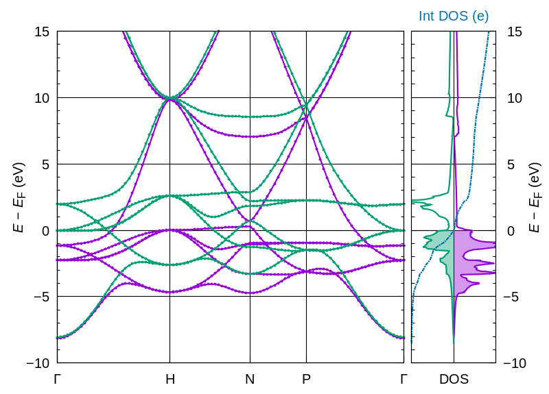

# 06: Band structure + DOS of bcc Fe

**Goal:** compute the spin-polarised **band structure** along Γ–H–N–P–Γ and plot it beside the DOS with `bands_run`.

| File | Purpose |
|------|---------|
| `Fe.in` | pw.x input for bcc Fe (loaded with `load_fromPWI`) |
| `Fe_bands.pwtk` | Overrides the cutoffs, smearing and k-mesh, then runs `bands_run` and `bands_plot` |
| `reference_results/` | Output from a previous run, including `spaghetti+dos.Fe.png`, for comparison |

## Run

```bash
pwtk Fe_bands.pwtk
```

Steps: SCF, NSCF (16×16×16, for the DOS), BANDS along the path (100 k-points), bands.x for spin up and spin down, dos.x, then the plot.
`-preserve` makes the BANDS run in a copy of `outdir`, so the SCF data are not overwritten.

## Outputs

* `spaghetti+dos.Fe.png`: band structure (left) and DOS + integrated DOS (right)
* `Fe.up.dat.gnu`, `Fe.dw.dat.gnu`: band energies for spin up and spin down
* `Fe.dos`: DOS

## Expected result



Reference values: E_F = 12.85 eV, total magnetisation = **2.31 μB/cell**, E_tot = −55.8018 Ry.

## Result analysis

1. Spin-up (lt 1) and spin-down (lt 2) bands have similar shapes but are **shifted by about 2 eV**: this is the exchange splitting.
2. Many bands cross E_F (= 0 eV), so Fe is a **metal**.
3. Flat bands near E_F give large DOS peaks. Match the band features to the DOS peaks.
4. Compare your plot with `reference_results/spaghetti+dos.Fe.png`.
